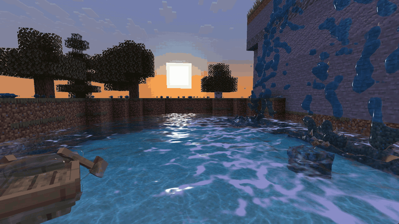
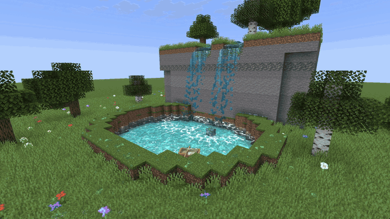
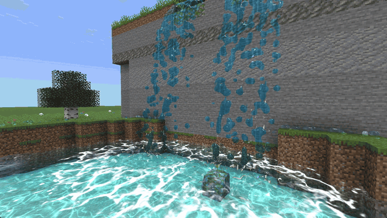
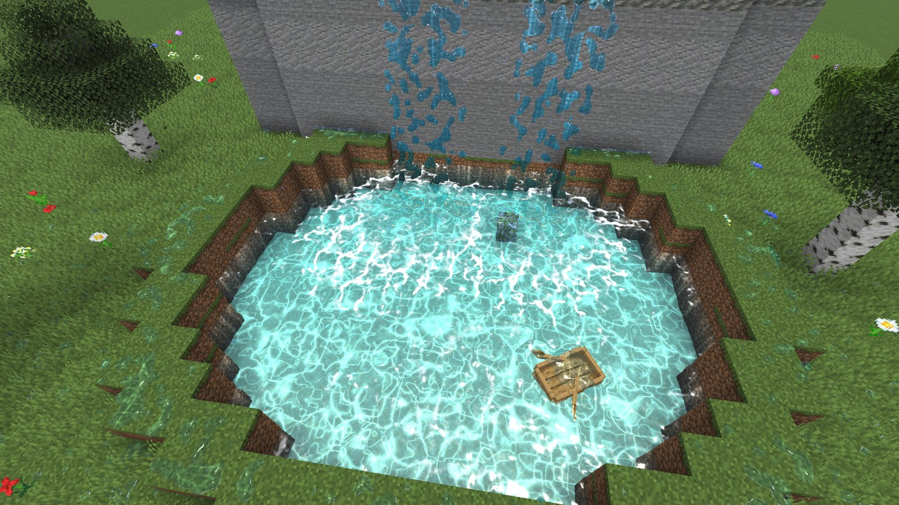
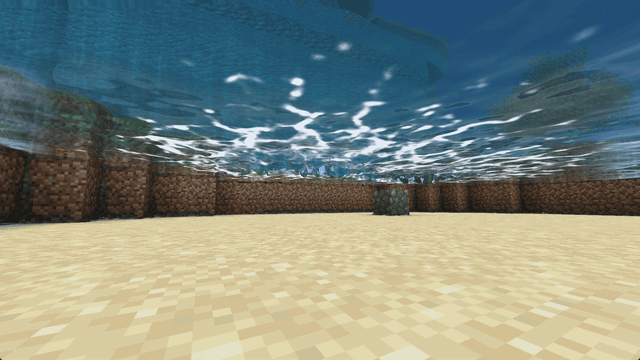

<h1 align="center">
  <picture>
    <source media="(prefers-color-scheme: dark)" srcset="docs/logo/inertia-logo-light.png">
    
  </picture>
</h1>

**Inertia is an advanced, professional physics engine for Minecraft: Java Edition.**



<table>
  <tr>
    <td width="50%"></td>
    <td width="50%"></td>
  </tr>
  <tr>
    <td width="50%"></td>
    <td width="50%"></td>
  </tr>
</table>

<sub>In game on Windows (RTX 4090 Laptop GPU, 1920 × 1080, 512 particles per block): about 210 FPS while the falls run.</sub>

Inertia adds real-time, GPU-simulated water powered by **NVIDIA PhysX 5**. Pour it
from a bucket and watch it splash, flow down stairs, pool in holes and push you around.

> **Requirements:** an NVIDIA GPU with a current driver (CUDA), Windows x64 or Linux x64,
> Minecraft 26.3 with Fabric Loader ≥ 0.20.1 and Fabric API. **Singleplayer only.**
> Without a CUDA-capable GPU the mod loads but stays inactive and tells you why.

## Download

Get the jar from the [Releases page](https://github.com/isnowx17/Inertia/releases). Inertia ships one jar per operating system because the PhysX GPU library is large
(about 250 MB unpacked per platform):

| Your system | File |
|---|---|
| Windows x64 | `inertia-<version>+26.3-windows.jar` |
| Linux x64 | `inertia-<version>+26.3-linux.jar` |

Put the jar into your `mods` folder together with Fabric API. On first launch the PhysX native
libraries are unpacked to `.minecraft/inertia/natives/` (this takes a few seconds, in the
background).

## Usage

- Take the **PhysX Water Bucket** from the *Tools & Utilities* creative tab.
- **Right-click** releases one block of water where you are looking. Hold right-click to keep
  pouring. The bucket never runs empty.
- The **PhysX Flowing Water Bucket** works like a water bucket placing a water source block: the
  source goes into the block in front of the face you click and keeps that block full of water,
  which flows out of it, down when there is room below, otherwise out along the ground. Put a block
  into the source (or click the same place again) to stop it; sneak + click stops all sources.
- `/inertia info` shows the GPU and simulation status, `/inertia clear` removes all water and
  stops all sources.

Water simulated by Inertia is separate from vanilla water: oceans, lakes and the normal water
bucket are unchanged. The water is not saved: it disappears when you leave the world.

## Settings

`config/inertia.json` (created on first launch):

| Setting | Default | Meaning |
|---|---|---|
| `quality` | `ultra` | `low`, `medium`, `high`, `ultra` or `custom`; see below. Lower it for more FPS. |
| `particleLimit` | 2097152 | Most water particles; the buffer grows up to this as you add water. |
| `keepRealTime` | true | Keep the water flowing at full speed: when the GPU cannot simulate more water in real time, new water replaces calm water, so the amount stops growing. When off, the water can grow up to `particleLimit` but runs in slow motion once the GPU cannot keep up. |
| `sourceFlow` | 3.0 | Water a flowing source lets out, in blocks of water per second (also its outflow speed). |
| `despawnDistance` | 96 | Water is simulated this far around you. Water further away is not removed: it sleeps as still water where it is (beyond twice this distance outside the simulation, not drawn) and comes back when you return. |
| `playerInteraction` | true | Whether water pushes, slows and lifts the player. |
| `waterShader` | true | Draw the water with Inertia's shader (refraction, depth colour, ripples, sun glints). Falls back automatically if unsupported. |
| `gpuSurface` | true | Build the water surface on the GPU every frame (with the water shader, NVIDIA OpenGL). Falls back to the CPU where it cannot work. |
| `waterSounds` | true | Minecraft's own water sounds for Inertia's water: splashes where it hits something, flowing water where it runs fast, the player splashing in and swimming, and the buckets. |
| `saveWater` | true | Save the water with the world, also water far away: the moving water, the still water and the flowing sources come back when you return. Saved when you leave, when the game saves, and every `autosaveSeconds`. |
| `autosaveSeconds` | 60 | Seconds between automatic saves of the water (10–3600). |
| `rippleStrength` | 1.0 | Strength of the surface ripples; 0 = perfectly smooth. |
| `refractionStrength` | 1.0 | How strongly the water bends what is behind it. |
| `waterAbsorption` | 1.0 | How quickly light is absorbed; higher makes deep water darker and bluer. |
| `reflections` | true | Reflect blocks and entities in the water (screen-space reflections). |
| `caustics` | 1.0 | Strength of the light patterns on the ground under the water; 0 = off. |
| `sunStrength` | 1.0 | Strength of the sun glint. |
| `renderMode` | `surface` | `surface`: one continuous water surface. `particles`: every particle as a sphere. |
| `surfaceSmoothness` | 2.0 | Surface smoothing radius relative to the surface cell size. |
| `surfaceThreshold` | 0.3 | Surface level as a fraction of still-water density. |
| `renderScale` | 1.6 | Size of spray droplets relative to the particle spacing. |
| `renderOpacity` | 0.6 | Opacity of the water when looking straight into it. |
| `foam` | true | Simulate and draw foam and spray. |
| `foamAmount` | 0.35 | How easily foam forms, 0–1. |
| `foamLifetime` | 3.0 | Average seconds foam lives (single bits live 0.8 to 2.3 times this). |
| `foamSize` | 1.0 | Width of the foam lines. |
| `foamCoverage` | 1.0 | How quickly overlapping foam turns opaque white. |
| `waterFriction` | 0.3 | Friction against blocks; higher makes water pool instead of sliding away. |
| `waterDamping` | 0.05 | Velocity damping. |
| `waterViscosity` | 0.01 | Viscosity; very high values feel like honey. |
| `waterSurfaceTension` | 0.002 | Surface tension; high values make thin water bead up. |
| `waterCohesion` | 0.02 | Cohesion; high values make thin water bead up. |
| `waterVorticity` | 4 | Keeps swirls alive. |

Quality levels (a bucket is always one block of water; changes apply after restarting the game):

| `quality` | Particles per block | Starting buffer | Surface cell | Sub-steps |
|---|---|---|---|---|
| `low` | 512 | 65,536 | 0.19 blocks | 2 |
| `medium` | 1000 | 131,072 | 0.15 blocks | 3 |
| `high` | 1728 | 262,144 | 0.125 blocks | 3 |
| `ultra` | 4096 | 524,288 | 0.1 blocks | 4 |
| `custom` | from `particleSpacing` | `maxParticles` | `surfaceCellSize` | `substepsPerTick` |

The particle buffer starts at the size above and doubles automatically when you add more water,
up to `particleLimit`.

## Building

Requires JDK 25.

```bash
./gradlew build -Pplatform=windows
```

```bash
./gradlew build -Pplatform=linux
```

The jars are written to `build/libs/`. Without `-Pplatform` the current operating system is
used. The CUDA build of physx-jni is downloaded from its GitHub release and its SHA-256 checksum
is verified during the build.

`./gradlew runBenchmark -PbenchLabel=<name> -PbenchScene=heavy` (or `light`) plays a fixed water scene
and writes frame times to `run-benchmark/benchmark/<name>.json`. It lives in `src/benchmark` and is
not part of the mod jar.

To publish a release, set `mod_version` in `gradle.properties`, add a `## [<version>]` entry to
`CHANGELOG.md` and push. If that version has not been released yet, GitHub Actions builds both
jars, creates the tag `v<version>` and publishes the release.

## How it works

- **PhysX PBD fluid** on the GPU via [physx-jni](https://github.com/fabmax/physx-jni) 2.5.1
  (PhysX 5.5.1), the last physx-jni release with CUDA support.
- **Block collision:** every 16×16×16 chunk section near the water becomes a static PhysX actor.
  Full blocks are greedily merged into large boxes, partial blocks use their collision boxes.
- **Player:** a kinematic box keeps the water out of the player; the force of the water on the
  player is computed from the particles around them.
- **Physics thread:** after every GPU step the positions and velocities are copied back and the
  per-particle work of the tick (lost particles, the water around the player, the blocks that need
  collision geometry) is done right there, off the game thread, in parallel chunks.
- **Real time:** the game never waits for the GPU; a game tick that comes while a step is running is
  simulated on the first frame after it finished. When a step gets close to a tick's length the
  simulation switches to a cheaper solver (three instead of four sub-steps at `ultra`). When even that
  is not enough, new water replaces calm water (`keepRealTime`): a source keeps pouring and a pool
  stops rising, so the water does not fall into slow motion.
- **Sleeping water:** water that has been still for a few seconds needs no physics steps: the GPU and
  the worker pool stay free, and only drawing remains (ripples and caustics are drawn by the shader
  and keep moving). New water, a block changing near the water or the player coming close wakes it up.
- **Surface:** for every new simulation result a background job builds one continuous water
  surface from the particles, in parallel on all spare cores: every particle is spread over the
  eight surrounding grid nodes, the density is smoothed with a small separable blur, and surface
  nets extract the surface. Bricks of the grid deep inside a body of water are skipped, and so are
  bricks the surface cannot cross. The job reads the simulation's arrays without copying them.
- **GPU surface** (`gpuSurface`): Inertia's own CUDA kernels (bound through Java's foreign
  function interface, compiled to PTX) run in PhysX's CUDA context, take each physics step's
  particles straight from the GPU and build the surface there every frame: the particles are spread
  over a sparse grid of 16³ bricks, smoothed, and surface nets write the vertices and indices right
  into the OpenGL buffers the game draws (CUDA-OpenGL interop, two buffers: one drawn while the next
  is built). The water is shown one tick behind and moved evenly between the last two physics steps.
  The CPU surface below is the fallback, and still feeds the foam.
- **Rendering:** the surface stays on the GPU: each new surface is uploaded once (one vertex per
  surface point, 32-bit indices), and every frame the vertex shader moves the vertices along their
  flow velocity for the time since the data was taken, so the water flows smoothly between
  updates and the CPU does no per-frame work for it. Seen from outside the water, the faces turned
  away from the camera are skipped; seen from inside, a depth pre-pass makes every pixel get shaded
  once. Water outside the view is not drawn at all. Spray and isolated splashes (small droplets)
  stay on the GPU too: one instance per particle, uploaded once per simulation step and turned into
  camera-facing quads by a vertex shader.
- **Water shader:** after the main level pass the scene colour and depth are copied, then the
  surface is drawn with Inertia's own shader in a separate render pass: refraction through
  ripple-distorted lookups, per-pixel absorption from the depth difference (clear shallows, blue
  depths), screen-space reflections of the surroundings, caustics on the ground below, Fresnel
  sky reflection and a sun glint. It is registered as an optional pipeline, so a
  compile failure only switches back to the simple rendering.
- **Foam:** up to 250,000 small foam tracers at the default `ultra` quality (40,000 at `low`)
  float on the top surface. They are spawned where the water churns (fast flow, and where PhysX spawns
  fresh diffuse particles at the surface), drift with the surface flow, are stirred by small eddies
  and pushed aside by boils (upwellings that sweep foam outwards, so it gathers into lines and
  rings), and fade after a few seconds. Stretched and folded by the flow they form swirling foam
  lines and patches. Every surface rebuild splats them into a top-down foam map (about 3 cm per
  texel at `ultra`, with mip levels) that the water shader samples; up close the foam breaks up into fine
  bubbles. Spray just above the water is drawn as small soft flecks.
- **Threads:** the GPU step runs on a physics thread, the surface and the foam are built on a
  worker pool below normal priority, and the game thread only collects results and draws.

See [PLAN.md](PLAN.md) for scope and versioning, and [CHANGELOG.md](CHANGELOG.md) for changes.

## Türkçe

Inertia, Minecraft: Java Edition için GPU üzerinde çalışan bir fizik motorudur. 0.1 sürümü
NVIDIA PhysX ile simüle edilen su ekler. NVIDIA ekran kartı (CUDA) gerekir, yalnızca tek
oyunculu çalışır. *Araçlar* sekmesindeki **PhysX Su Kovası** ile sağ tıklayarak su dökebilirsin.
Ayrıntılar için [PLAN.md](PLAN.md).

## License

Inertia is licensed under the [GNU AGPL-3.0](LICENSE). It bundles physx-jni (MIT) and NVIDIA
PhysX (BSD-3-Clause).
